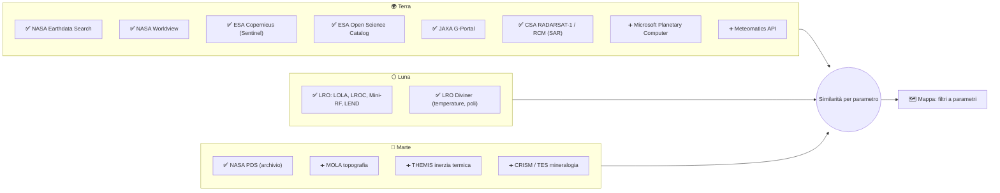

# AGENTS.md — NASA Space Apps 2026 · Team FVG Station

## Contesto

- **Evento:** NASA Space Apps Challenge 2026, evento locale di Torino (incubatore del Politecnico), 14-15 novembre 2026.
- **Pagina evento:** https://www.spaceappschallenge.org/2026/local-events/turin/
- **Team:** FVG Station
  - Timo: web dev, frontend e UI della mappa
  - Edo: matematica, ML, pipeline dati
  - Rocco: ingegnere delle nanotecnologie, ricerca; sfrutta le basi di chimica e fisica
- **Challenge scelta:** *Identify Earth Locations that Analog the Permanent Moon Base Locations and Mars*
  https://www.spaceappschallenge.org/2026/challenges/permanent-moon-base-locations-and-mars/
- **Testo completo:** `fonti/challenge.txt`. **Risorse ufficiali:** `fonti/resources.txt`

## Cosa chiede la challenge (in breve)

Usare dati aperti su Terra, Luna e Marte per trovare e caratterizzare posti sulla Terra analoghi a future basi lunari o a siti di atterraggio su Marte. Il risultato va presentato come mappa, visualizzazione o tool.

Cosa conta per i giudici, dal testo:
- **Non** riscoprire gli analoghi noti (Atacama, Antartide, Islanda, Hawaii). Il premio va all'analogo inatteso ("Surprise us").
- Andare oltre la somiglianza visiva: spiegare coi dati **cosa** è analogo e **dove l'analogia non regge**.
- Le dimensioni di confronto: geologia e mineralogia, topografia (quota, pendenza, rugosità, crateri), temperatura e illuminazione, acqua, ghiaccio e permafrost, polvere e vento, biologia ed estremofili, sottosuolo (grotte, tubi di lava), operatività (atterraggio, mobilità, costruzione).
- La scala conta: un singolo cratere o una singola valle vale più di un deserto intero.
- Dichiarare i limiti della Terra come analogo: gravità, vuoto lunare, atmosfera marziana sottile, radiazioni.
- Vanno bene metriche di similarità, ML e GIS.

## La nostra idea

Una mappa della Terra con una UI particolare. L'utente sceglie un target (Luna, o un sito o una base specifica, oppure Marte) e attiva dei **parametri** (temperatura, pendenza, quota, ghiaccio, mineralogia…). Per ogni parametro si calcola la similarità dei luoghi terrestri col target. Ogni parametro in più **restringe** i risultati: restano solo i posti che li rispettano tutti. Per ogni risultato si mostra cosa combacia e cosa no.

Aggancio narrativo possibile: analoghi poco studiati in Italia o in FVG (il Carso con le sue grotte, il Tagliamento, i ghiaioni delle Dolomiti friulane). Va verificato coi dati, non dato per buono.

## Dati: cosa ci danno

Legenda: ✅ = nelle risorse ufficiali della challenge · ➕ = non elencato, suggerito da noi (accesso da verificare)

### Parametro → sorgente per ogni corpo

| Parametro | Terra | Luna | Marte |
|---|---|---|---|
| Quota, pendenza, rugosità | SRTM / NASADEM (Earthdata) ➕ Copernicus DEM (Planetary Computer) | ✅ LOLA (LRO) | ➕ MOLA (PDS) |
| Temperatura ed escursione termica | ✅ MODIS LST (Earthdata) ➕ Meteomatics | ✅ Diviner | ➕ THEMIS / TES (PDS) |
| Illuminazione e ombra permanente | calcolabile da DEM + latitudine | ✅ LOLA / Diviner (prodotti polari) | ➕ da MOLA |
| Ghiaccio, permafrost, acqua | ✅ Sentinel / RADARSAT, ✅ JAXA (neve) | ✅ LEND, Mini-RF, Diviner | ➕ PDS (dati di neutroni e radar) |
| Mineralogia e materiali di superficie | ✅ Sentinel-2 / Landsat (Earthdata), ASTER | ✅ LROC + PDS | ➕ CRISM / TES |
| Vegetazione (assente = più analogo) | ✅ MODIS NDVI, ➕ ESA WorldCover | n/a (zero) | n/a (zero) |
| Rugosità radar e struttura di superficie | ✅ RADARSAT SAR, Sentinel-1 | ✅ Mini-RF | ➕ PDS (SHARAD) |
| Polvere e vento | ✅ Earthdata (aerosol), ➕ Meteomatics | n/a | ➕ PDS (atmosfera) |
| Immagini per l'occhio | ✅ Worldview | ✅ LROC | ➕ HiRISE / CTX (PDS) |

Nota: per Marte la challenge elenca solo il PDS, senza dataset specifici. I global map di MOLA, THEMIS e CRISM vanno presi lì da noi.

## Fonti dati (link)

**Terra**
- NASA Earthdata Search: https://search.earthdata.nasa.gov (serve un account Earthdata Login, gratuito)
- NASA Worldview: https://worldview.earthdata.nasa.gov
- ESA Copernicus Data Space: https://dataspace.copernicus.eu
- ESA Open Science Catalog: https://opensciencedata.esa.int
- JAXA G-Portal: https://gportal.jaxa.jp/gpr/
- CSA RADARSAT Constellation (RCM): https://donnees-data.asc-csa.gc.ca/en/dataset/rcm
- CSA RADARSAT-1: https://donnees-data.asc-csa.gc.ca/en/dataset/radarsat1
- Tutorial SAR in Python + QGIS: https://github.com/asc-csa/Synthetic_Aperture_Radar_Tutorial

**Luna e Marte**
- NASA PDS: https://pds.nasa.gov
- LRO (PDS Geosciences): https://pds-geosciences.wustl.edu/missions/lro/
- LRO Diviner: https://pds-geosciences.wustl.edu/missions/lro/diviner.htm

## Strumenti gratuiti (Global Offers)

Si riscattano da https://www.spaceappschallenge.org/2026/global-offers/ (serve il login Space Apps). I limiti esatti (crediti, durata, carta di credito) non sono ancora verificati.

| Provider | Cosa offre | Utile per noi |
|---|---|---|
| Microsoft | Azure, **Planetary Computer**, GitHub Copilot, Teams | Planetary Computer: dati della Terra pronti via STAC API, senza download manuali |
| Google Cloud | GCP, Firebase, Maps API | hosting, base della mappa |
| Meteomatics | API meteo, clima, ambiente | temperature estreme e vento sulla Terra |
| GoDaddy | dominio gratis + 1 anno di hosting | URL della demo |
| Miro | piano Education e Business, template ufficiali | brainstorming e pitch |

Avviso dalla mail NASA: alcune offerte chiedono la carta di credito per la verifica, ma sono gratuite e non obbligano ad acquistare nulla.

## Link utili dell'hackathon

- Project Submission Guide: https://www.spaceappschallenge.org/resources/project-submission-guide/
- Judging & Awards Guide: https://www.spaceappschallenge.org/resources/judging-awards-guide/
- Participant FAQs: https://www.spaceappschallenge.org/resources/participant-faqs/
- Space Apps Connect (forum, domande agli esperti): https://www.spaceappschallenge.org/resources/space-app-connect-guide/
- Repo NASA Space Apps: https://github.com/nasa/spaceapps

## Regole per l'agente

- **`findings.md` è il report vivo del team.** A ogni scoperta, decisione o rischio nuovo, aggiorna la sezione pertinente e aggiungi una riga datata in cima a "Log aggiornamenti". Non riscriverlo da zero.
- Le scadenze di submission si verificano sulla Project Submission Guide, non si deducono.
- Ogni dataset ➕ va verificato (accesso, formato, risoluzione) prima di costruirci sopra.
- Prima un MVP con 2 o 3 parametri che funzionano (es. quota/pendenza + temperatura + vegetazione), poi si aggiunge il resto.
- **ORARIO / SCADENZA (check ricorrente):** l'evento finisce **domenica 15 novembre 2026, 16:00 (ora di Roma)** — dato dichiarato dal team, da ricontrollare sulla Project Submission Guide.
  - A inizio di quasi ogni sessione — e a ogni cambio di focus, *non* a ogni singolo messaggio — l'agente controlla l'ora corrente e dichiara quante ore/minuti mancano alla deadline.
  - Sotto le **~6 ore** restanti lo segnala in modo prominente e mette la submission prima di tutto il resto.
