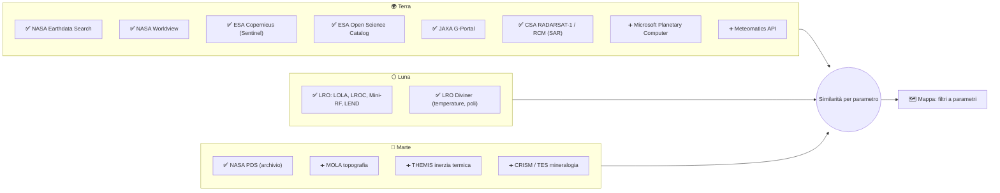

# AGENTS.md — NASA Space Apps 2026 · Team FVG Station

## 0. Prima di tutto: chi è l'utente?

Questa repo è condivisa da Timo, Edo e Rocco. **Prima di modificare qualsiasi file**, identifica l'utente:

1. Esegui `git config user.name` e confronta con la tabella sotto (match parziale, maiuscole ignorate).
2. Nessun match o dubbio → **chiedi all'utente chi è** prima di scrivere. Fino alla risposta lavori in sola lettura.
3. Dichiara all'inizio della sessione: "Lavoro come <nome>, posso scrivere in: <cartelle>".

| Membro | `git config user.name` contiene | Ruolo |
|---|---|---|
| Timo | `Timoteo`, `teemoteeo` | web dev, frontend, UI della mappa, deploy |
| Edo | `Edo` | matematica, ML, pipeline dati |
| Rocco | `Rocco` | chimica e fisica, ricerca scientifica |

Se un compagno usa un nome git diverso, aggiunge il suo alias in questa tabella.

## 1. Struttura della repo

```
AGENTS.md        regole per gli agent (questo file)
CLAUDE.md        rimanda qui, per Claude Code
docs/            documenti vivi del team
  decisioni.md   FONTE UNICA: prodotto, target, prossimi passi, ruoli, orari
  requirements.md  requisiti di challenge, giuria e pitch
  mercato.md     ricerca di mercato, competitor, clienti
  fonti/         testo della challenge e risorse ufficiali
data/            dataset: grezzi (raw/, fuori da git), processati, export per la mappa
  datasets_links.md  spec dei dataset: portali, collection, a cosa servono (Edo)
src/web/         frontend: mappa, UI, deploy
src/pipeline/    pipeline dati, metrica di similarità, ML
archive/         piano vecchio (Jezero, twist), findings, briefing, reference: solo consultazione
human_docs/      appunti personali di Edo
```

## 2. Scope: chi può toccare cosa

| Cartella | Timo | Edo | Rocco |
|---|---|---|---|
| `src/web/` | ✏️ scrive | 👁️ legge | 👁️ legge |
| `src/pipeline/` | 👁️ legge | ✏️ scrive | 👁️ legge |
| `data/` | 👁️ legge | ✏️ scrive | ✏️ scrive |
| `docs/` (tranne `decisioni.md`) | ✏️ i propri file | ✏️ i propri file | ✏️ i propri file |
| `docs/decisioni.md` | 👁️ legge | 👁️ legge | ✏️ scrive |
| `archive/` | 👁️ legge | 👁️ legge | 👁️ legge |
| file in root (`AGENTS.md`, `CLAUDE.md`, `README.md`, `.gitignore`) | ✏️ scrive | 👁️ legge | 👁️ legge |

Regole:
- **Fuori dal proprio scope non si scrive, anche se l'utente lo chiede di passaggio.** Avvisa che la cartella è di un altro membro e proponi l'alternativa: una nota in `docs/` per il proprietario, oppure chiedi conferma esplicita ("sì, tocca src/web anche se non è mio").
- Leggere tutto è sempre permesso.
- Il **contratto tra pipeline e mappa** è il formato dei file in `data/` che il frontend consuma. Chi lo cambia lo scrive in una sua nota in `docs/` e lo dice a Rocco, che lo riporta in `decisioni.md`.
- In `docs/` ognuno modifica solo i propri file.
- **`docs/decisioni.md` lo scrive solo Rocco.** Due persone che modificano lo stesso file a pochi minuti di distanza vanno in conflitto. Timo ed Edo scrivono in file propri in `docs/` e Rocco riporta le decisioni.
- `2005-Citadel/` è fuori dalla repo (in `.gitignore`): non toccarla.

## 3. Git: regole per lavorare in tre

- `git pull` prima di iniziare e prima di ogni commit. Una volta per clone: `git config pull.rebase true`, così niente merge commit inutili.
- Commit e push a blocchi di lavoro, non a ogni nota.
- Commit piccoli, solo dei file nel proprio scope. Mai `git add -A` alla cieca: controlla `git status`.
- Mai `git push --force`, mai riscrivere la storia di `main`.
- Conflitto su un file di un altro membro → non risolverlo da solo, chiedi.
- Niente segreti nei commit: chiavi API (Cesium ion, Google, Earthdata) vanno in `.env`, che è ignorato.

## Contesto

- **Evento:** NASA Space Apps Challenge 2026, evento locale di Torino (incubatore del Politecnico), 14-15 novembre 2026.
- **Pagina evento:** https://www.spaceappschallenge.org/2026/local-events/turin/
- **Orari ufficiali (pagina evento):** inizio hackathon sab 16:00 · deadline submission dom 16:00 · pitch dom 16:15 · premiazione 17:30. Prossimi passi e gate: `docs/decisioni.md`.
- **Submission (Project Submission Guide):** demo = 7 slide (titolo incluso) **oppure** video ≤30 s, oltre si è esclusi dal giudizio globale; link pubblici senza login; almeno un dato NASA; uso dell'AI dichiarato nel form.
- **Team:** FVG Station
  - Timo: web dev, frontend e UI della mappa
  - Edo: matematica, ML, pipeline dati
  - Rocco: ingegnere delle nanotecnologie, ricerca; sfrutta le basi di chimica e fisica
- **Challenge scelta:** *Identify Earth Locations that Analog the Permanent Moon Base Locations and Mars*
  https://www.spaceappschallenge.org/2026/challenges/permanent-moon-base-locations-and-mars/
- **Testo completo:** `docs/fonti/challenge.txt`. **Risorse ufficiali:** `docs/fonti/resources.txt`

## Cosa chiede la challenge (in breve)

Usare dati aperti su Terra, Luna e Marte per trovare e caratterizzare posti sulla Terra analoghi a future basi lunari o a siti di atterraggio su Marte. Il risultato va presentato come mappa, visualizzazione o tool.

Cosa conta per i giudici, dal testo:
- **Non** riscoprire gli analoghi noti (Atacama, Antartide, Islanda, Hawaii). Il premio va all'analogo inatteso ("Surprise us").
- Andare oltre la somiglianza visiva: spiegare coi dati **cosa** è analogo e **dove l'analogia non regge**.
- Le dimensioni di confronto: geologia e mineralogia, topografia (quota, pendenza, rugosità, crateri), temperatura e illuminazione, acqua, ghiaccio e permafrost, polvere e vento, biologia ed estremofili, sottosuolo (grotte, tubi di lava), operatività (atterraggio, mobilità, costruzione).
- La scala conta: un singolo cratere o una singola valle vale più di un deserto intero.
- Dichiarare i limiti della Terra come analogo: gravità, vuoto lunare, atmosfera marziana sottile, radiazioni.
- Vanno bene metriche di similarità, ML e GIS.

## La nostra idea

Vedi **`docs/decisioni.md`** (fonte unica). In breve: un tool che dice dove sulla Terra testare hardware lunare, partendo dal tipo di test. Target: i 9 siti candidati di Artemis III al Polo Sud. Clienti: le aziende di Torino (Thales Alenia, ALTEC, Argotec…). Jezero e la lista dei twist sono in `archive/analog-atlas-plan.md`, solo come storia.

## Dati: cosa ci danno

**La spec aggiornata dei dataset (target Artemis III) è in `data/datasets_links.md`.** La tabella sotto viene dal piano vecchio: le righe e la colonna su Marte non servono più.

Legenda: ✅ = nelle risorse ufficiali della challenge · ➕ = non elencato, suggerito da noi (accesso da verificare)



### Parametro → sorgente per ogni corpo

| Parametro | Terra | Luna | Marte |
|---|---|---|---|
| Quota, pendenza, rugosità | SRTM / NASADEM (Earthdata) ➕ Copernicus DEM (Planetary Computer) | ✅ LOLA (LRO) | ➕ MOLA (PDS) |
| Temperatura ed escursione termica | ✅ MODIS LST (Earthdata) ➕ Meteomatics | ✅ Diviner | ➕ THEMIS / TES (PDS) |
| Illuminazione e ombra permanente | calcolabile da DEM + latitudine | ✅ LOLA / Diviner (prodotti polari) | ➕ da MOLA |
| Ghiaccio, permafrost, acqua | ✅ Sentinel / RADARSAT, ✅ JAXA (neve) | ✅ LEND, Mini-RF, Diviner | ➕ PDS (dati di neutroni e radar) |
| Mineralogia e materiali di superficie | ✅ Sentinel-2 / Landsat (Earthdata), ASTER | ✅ LROC + PDS | ➕ CRISM / TES |
| Vegetazione (assente = più analogo) | ✅ MODIS NDVI, ➕ ESA WorldCover | n/a (zero) | n/a (zero) |
| Rugosità radar e struttura di superficie | ✅ RADARSAT SAR, Sentinel-1 | ✅ Mini-RF | ➕ PDS (SHARAD) |
| Polvere e vento | ✅ Earthdata (aerosol), ➕ Meteomatics | n/a | ➕ PDS (atmosfera) |
| Immagini per l'occhio | ✅ Worldview | ✅ LROC | ➕ HiRISE / CTX (PDS) |

Nota: per Marte la challenge elenca solo il PDS, senza dataset specifici. I global map di MOLA, THEMIS e CRISM vanno presi lì da noi.

## Fonti dati (link)

**Terra**
- NASA Earthdata Search: https://search.earthdata.nasa.gov (serve un account Earthdata Login, gratuito)
- NASA Worldview: https://worldview.earthdata.nasa.gov
- ESA Copernicus Data Space: https://dataspace.copernicus.eu
- ESA Open Science Catalog: https://opensciencedata.esa.int
- JAXA G-Portal: https://gportal.jaxa.jp/gpr/
- CSA RADARSAT Constellation (RCM): https://donnees-data.asc-csa.gc.ca/en/dataset/rcm
- CSA RADARSAT-1: https://donnees-data.asc-csa.gc.ca/en/dataset/radarsat1
- Tutorial SAR in Python + QGIS: https://github.com/asc-csa/Synthetic_Aperture_Radar_Tutorial

**Luna e Marte**
- NASA PDS: https://pds.nasa.gov
- LRO (PDS Geosciences): https://pds-geosciences.wustl.edu/missions/lro/
- LRO Diviner: https://pds-geosciences.wustl.edu/missions/lro/diviner.htm

## Strumenti gratuiti (Global Offers)

Si riscattano da https://www.spaceappschallenge.org/2026/global-offers/ (serve il login Space Apps). I limiti esatti (crediti, durata, carta di credito) non sono ancora verificati.

| Provider | Cosa offre | Utile per noi |
|---|---|---|
| Microsoft | Azure, **Planetary Computer**, GitHub Copilot, Teams | Planetary Computer: dati della Terra pronti via STAC API, senza download manuali |
| Google Cloud | GCP, Firebase, Maps API | hosting, base della mappa |
| Meteomatics | API meteo, clima, ambiente | temperature estreme e vento sulla Terra |
| GoDaddy | dominio gratis + 1 anno di hosting | URL della demo |
| Miro | piano Education e Business, template ufficiali | brainstorming e pitch |

Avviso dalla mail NASA: alcune offerte chiedono la carta di credito per la verifica, ma sono gratuite e non obbligano ad acquistare nulla.

## Link utili dell'hackathon

- Project Submission Guide: https://www.spaceappschallenge.org/resources/project-submission-guide/
- Judging & Awards Guide: https://www.spaceappschallenge.org/resources/judging-awards-guide/
- Participant FAQs: https://www.spaceappschallenge.org/resources/participant-faqs/
- Space Apps Connect (forum, domande agli esperti): https://www.spaceappschallenge.org/resources/space-app-connect-guide/
- Repo NASA Space Apps: https://github.com/nasa/spaceapps

## Regole per l'agente

- **`docs/decisioni.md` è la fonte unica e lo scrive solo Rocco.** Se l'utente è Rocco, aggiornalo a ogni decisione nuova senza riscriverlo da zero. Se l'utente è Timo o Edo, scrivi in un file suo in `docs/` e ricordagli di segnalarlo a Rocco.
- **Output brevi.** Il team non legge risposte lunghe: prima la risposta, poco testo e niente ripetizioni. Si va nel dettaglio solo se l'utente lo chiede o se fa brainstorming.
- Le scadenze di submission si verificano sulla Project Submission Guide, non si deducono.
- Ogni dataset ➕ va verificato (accesso, formato, risoluzione) prima di costruirci sopra.
- Prima un MVP con 2 o 3 parametri che funzionano (proposta: i preset mobilità e ISRU/materiale, vedi `docs/decisioni.md`), poi si aggiunge il resto.
- **ORARIO / SCADENZA (check ricorrente):** la submission chiude **domenica 15 novembre 2026, 16:00 (ora di Roma)**, pitch alle 16:15. Verificato sul programma della pagina evento di Torino; la pagina indica il fuso "Greenwich", da confermare all'intro delle 15:00. La deadline globale della Submission Guide (dom 23:59, ora locale) per noi non conta: vale quella locale.
  - A inizio di quasi ogni sessione — e a ogni cambio di focus, *non* a ogni singolo messaggio — l'agente controlla l'ora corrente e dichiara quante ore/minuti mancano alla deadline.
  - Sotto le **~6 ore** restanti lo segnala in modo prominente e mette la submission prima di tutto il resto.
