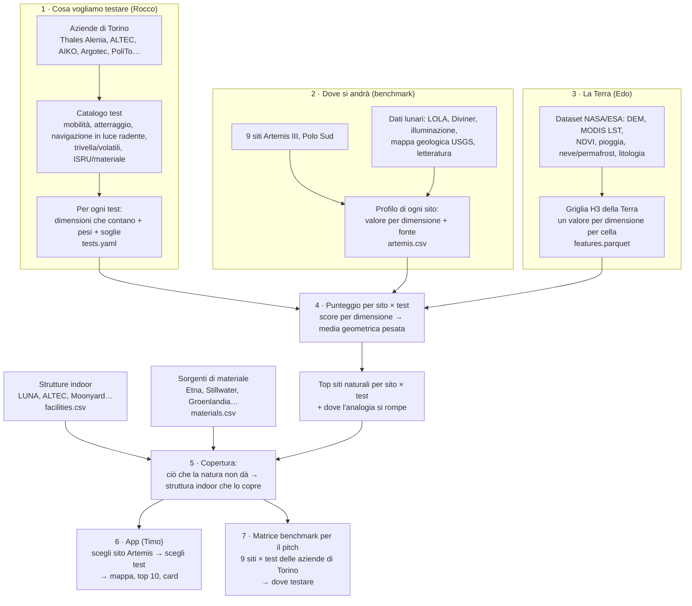

# Requirements tecnici — bozza da approvare

Autore: Timo · 2026-11-14 17:45. Prodotto e target in `docs/decisioni.md`. Il modello di punteggio è quello del piano vecchio (`archive/analog-atlas-plan.md` §5), invariato: è indipendente dal target.

## 1. Il flusso



## 2. Input: il catalogo dei test (Rocco)

Per ogni test servono questi campi:

| Campo | Esempio |
|---|---|
| `id`, `nome` | `mobility` · Mobilità del rover |
| `aziende` | Thales Alenia (rover Etna), PoliTo DIANA, ispace-EUROPE via ALTEC |
| `pesi` per dimensione (somma 1, minimo 0,05) | terreno 0,45 · regolite 0,25 · illuminazione 0,10 · … |
| `soglie` (filtri duri) | pendenza p90 ≥ 15° · NDVI ≤ 0,1 |
| `indoor` | cosa la natura non dà e serve la struttura: vuoto, −200 °C, polvere elettrostatica |

Bozza dei test da confermare con l'analisi delle aziende. I pesi sono segnaposto.

| Test | Terreno | Illuminazione | Termico | Composizione | Regolite/sciolto | Ghiaccio | Chi a Torino |
|---|---|---|---|---|---|---|---|
| Mobilità rover | 0,45 | 0,05 | 0,10 | 0,05 | 0,30 | 0,05 | Thales Alenia (Etna), DIANA, ispace via ALTEC |
| Navigazione in luce radente | 0,30 | 0,45 | 0,05 | 0,05 | 0,10 | 0,05 | AIKO, PIC4SeR, Thales Alenia |
| Trivella e volatili | 0,10 | 0,05 | 0,25 | 0,15 | 0,10 | 0,35 | Leonardo (ProSEED, non di Torino) |
| ISRU e materiale | 0,05 | 0,05 | 0,05 | 0,60 | 0,20 | 0,05 | PoliMi, ALTEC (riempimento della hall) |
| Atterraggio (GNC, lidar) | 0,50 | 0,30 | 0,05 | 0,05 | 0,05 | 0,05 | Thales Alenia (Argonaut) |

**MVP:** mobilità + ISRU/materiale. Navigazione in luce radente è il terzo candidato: costa poco perché l'illuminazione si calcola dalla latitudine, e parla direttamente ad AIKO e a Thales Alenia.

## 3. Target: i 9 siti Artemis III

`data/config/targets/artemis.csv`, una riga per sito:

```csv
site,lat,lon,slope_p10,slope_p90,roughness,sun_elev_max_deg,illum_pct,t_min_c,t_max_c,geo_unit,rock_class,ice_nearby,source
```

- **Valori dai DEM polari LOLA e da Diviner** (scelta di Edo, 14/11 18:10). Prodotti e collection in `data/datasets_links.md`.
- `geo_unit` viene dalla mappa geologica USGS (`human_docs/geologia-luna.md`). `rock_class` è la classe terrestre equivalente, per esempio anortosite/gabbro o breccia da impatto.
- Lista NASA di ott 2024 (da verificare se aggiornata): Peak near Cabeus B, Haworth, Malapert Massif, Mons Mouton Plateau, Mons Mouton, Nobile Rim 1, Nobile Rim 2, de Gerlache Rim 2, Slater Plain.

## 4. Dimensioni: dato lunare e dato terrestre

**I dataset li decide `data/datasets_links.md` (Edo).** Se questa tabella non torna, vale quel file.

| Dimensione | Luna (target) | Terra (per cella H3) | Dove si rompe |
|---|---|---|---|
| Terreno: pendenza, rugosità, rilievo | DEM polari LOLA | `NASADEM_HGT` + `ASTGTM` | Scala: H3 res 5 ≈ 250 km², quindi zoom sui migliori |
| Illuminazione: elevazione massima del sole, notte | sole ≤ ~1,5°, % di illuminazione | **calcolata dalla latitudine**, nessun download | Sulla Terra c'è l'atmosfera (luce diffusa); il sole radente c'è solo d'inverno |
| Termico: minimo, massimo, escursione | Diviner | MODIS LST `MOD11C3` | La Terra non scende a −200 °C: serve un'altra struttura (camera termo-vuoto ALTEC) |
| Composizione / litologia | mappa geologica USGS → `rock_class` | layer scritto a mano dalla letteratura (`materials.csv`); ASTER ed EMIT facoltativi | EMIT copre solo le zone aride e non vede il plagioclasio |
| Regolite e materiale sciolto | regolite fine e tagliente | temperatura e albedo MODIS come proxy della granulometria + niente vegetazione (`MOD13C2`) | Grani arrotondati contro grani taglienti (lo ha detto la mentor) |
| Ghiaccio e volatili | PSR vicini, LEND, Mini-RF | neve `MOD10CM`, permafrost ESA CCI | Ghiaccio d'acqua normale contro ghiaccio in regolite a −230 °C |
| Quota (spunto del team) | vuoto | quota come proxy di pressione e radiazione | Il vuoto non si raggiunge mai |
| Sempre | gravità a 1/6, vuoto, radiazioni | — | Va scritto su ogni card |

## 5. Punteggio

Si usa il modello di `archive/analog-atlas-plan.md` §5.2:
- distanza in percentili terrestri;
- `s = exp(−(D/τ)²)` per dimensione;
- media geometrica pesata con i pesi del test;
- le soglie del test come filtri duri;
- confidenza κ ≥ 0,7.

Il fitting dei pesi con ML è **stretch**: l'MVP usa i pesi scritti a mano nel catalogo dei test.

Da celle a siti: top 1% delle celle, poi si uniscono quelle vicine, poi al massimo un sito ogni 100 km.

**Copertura:** per ogni coppia sito × test, le dimensioni con `s < 0,3` sono "si rompe". Per ognuna l'app propone la struttura indoor di `facilities.csv` che la copre.

## 6. File (contratti)

| File | Owner | Contenuto |
|---|---|---|
| `data/config/tests.yaml` | Rocco | catalogo dei test (§2) |
| `data/config/targets/artemis.csv` | Rocco | 9 siti (§3) |
| `data/config/facilities.csv` | Rocco, aiuta Timo | `name,lat,lon,type,simulant,covers,url`. `covers` = dimensioni o condizioni che riproduce (es. `thermal_vacuum`, `regolith_bed`) |
| `data/config/materials.csv` | Rocco | `name,lat,lon,rock_class,evidence_url` (Etna, Stillwater, Groenlandia, Lofoten, Lanzarote…) |
| `data/raw/` | Edo | dati scaricati, **fuori da git** |
| `data/export/scores.csv` | Edo | `h3,terrain,illumination,thermal,composition,regolith,ice,altitude`, ognuno 0–255, vuoto = nessun dato |
| `data/export/sites/<site>__<test>.json` | Edo | top siti naturali, score per dimensione, totale, "si rompe" |
| `data/export/benchmark.json` | Edo | matrice 9 × test: miglior sito naturale + struttura indoor |

**Export di prova** con valori finti, per sbloccare l'app: Edo lo consegna entro le 20:00.

## 7. App (Timo)

- **Flusso:**
  1. mappa polare della Luna con i 9 siti;
  2. scelta del test;
  3. heat map H3 della Terra (deck.gl su MapLibre), top 10, pin delle strutture e dei materiali;
  4. click su un risultato → card.
- **Card:** barre per dimensione, "combacia / si rompe", struttura indoor che copre il buco, fonti.
- **Vista benchmark:** la matrice 9 siti × test, che è anche la slide del pitch.
- Statica, senza backend, link pubblico senza login.
- **Fuori dall'MVP:** l'intro con la navicella e la discesa 3D. Si fanno solo se il resto è finito entro dom 11:00.

## 8. Gate

Vedi `docs/decisioni.md`.

## 9. Domande aperte

- Le 5 aziende di Rocco: quali sono, e quali test fanno davvero? Da qui cambiano i pesi del §2.
- Il terzo test, navigazione in luce radente: lo mettiamo?
